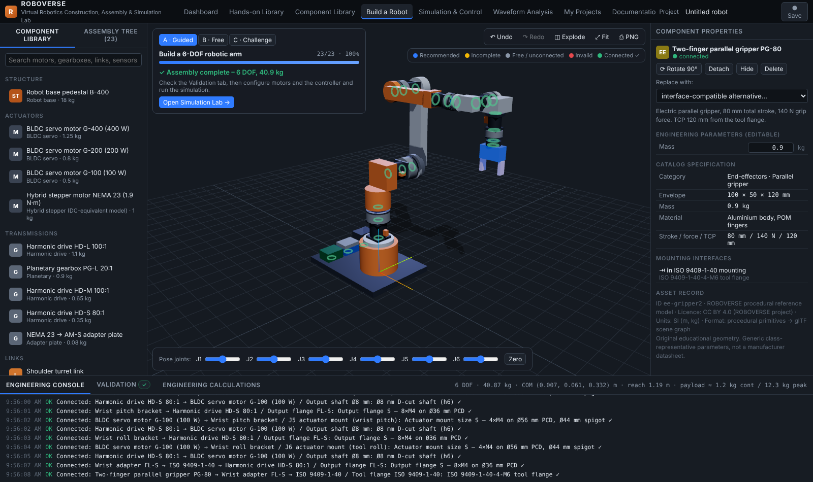
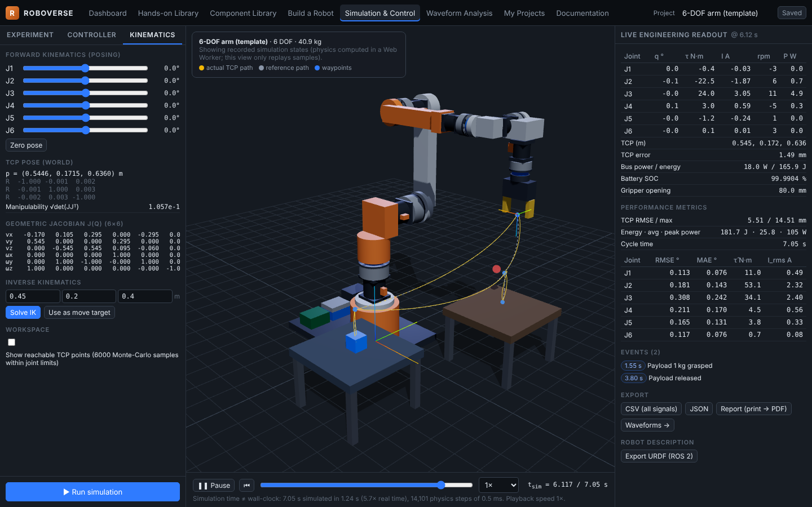
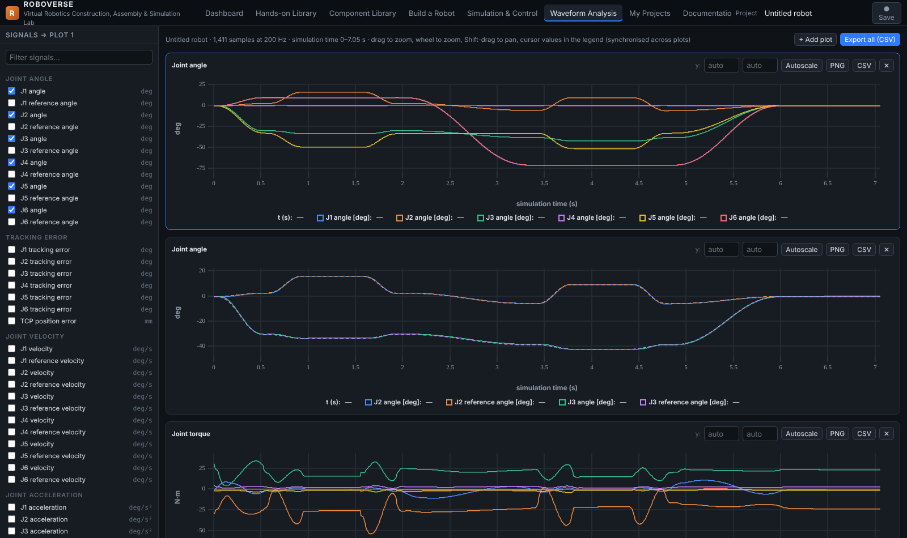
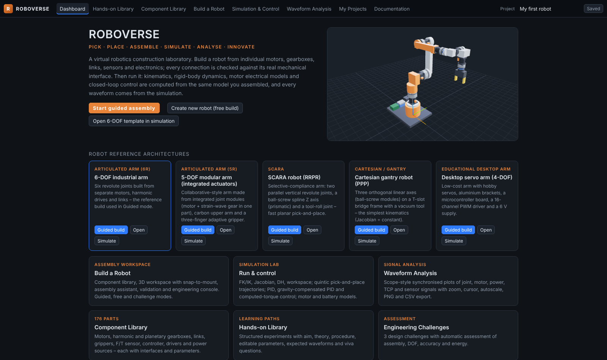
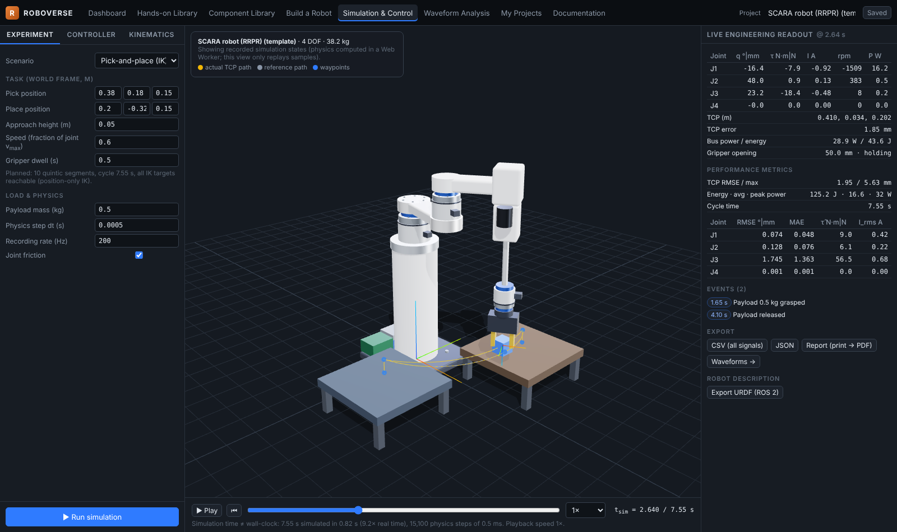
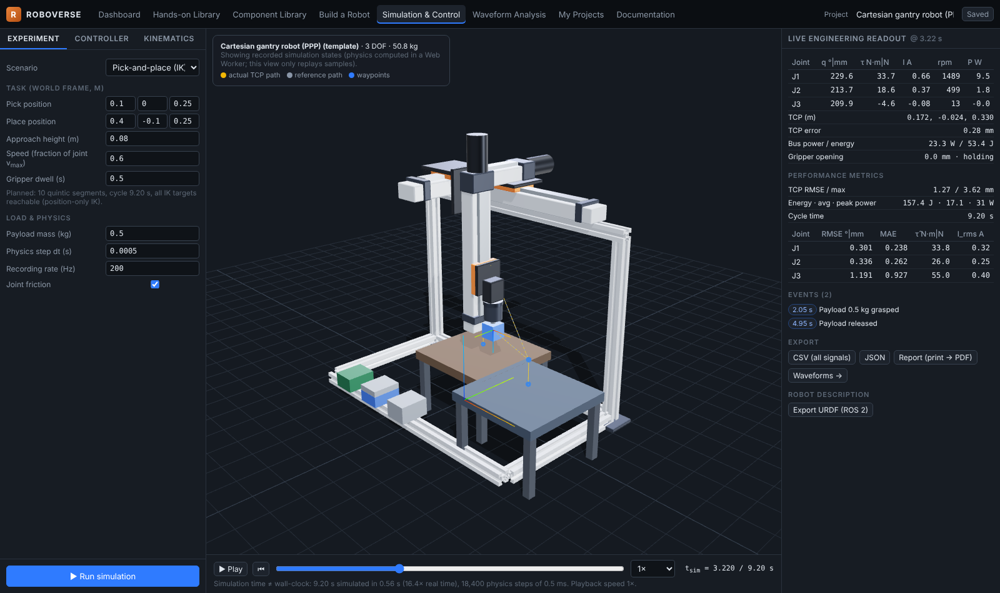
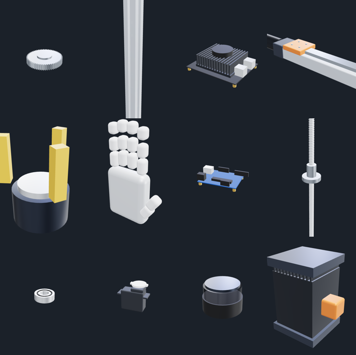
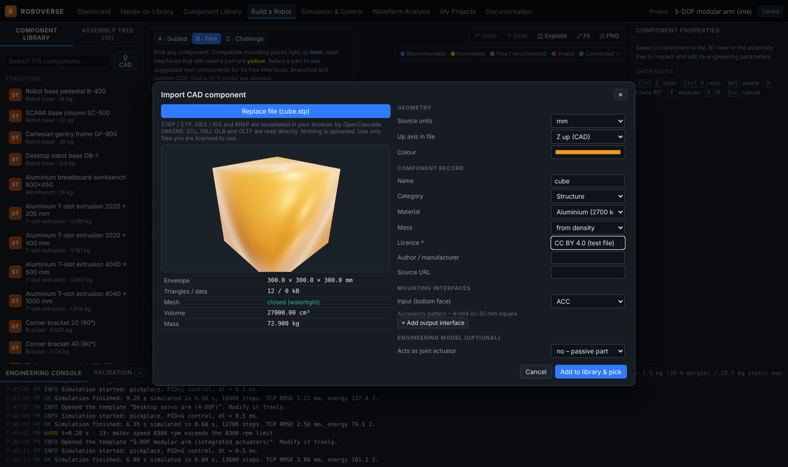

# ROBOVERSE – Virtual Robotics Construction, Assembly & Simulation Laboratory

**Pick · Place · Assemble · Simulate · Analyse · Innovate**

[](https://github.com/aya430/roboverse-robotics-laboratory/actions/workflows/deploy.yml)
[](https://github.com/aya430/roboverse-robotics-laboratory/actions/workflows/ci.yml)

### ▶ Live laboratory: **https://aya430.github.io/roboverse-robotics-laboratory/**

> ROBOVERSE is an **educational robotics simulation environment**. Component parameters are generic,
> class-representative educational values — **not manufacturer-certified specifications**.

ROBOVERSE is a browser-based robotics laboratory in which students build a robot from individual
engineering components (motors, gearboxes, links, grippers, sensors, controller, driver, battery),
have every connection checked against its real mechanical interface, and then run the robot:
kinematics, rigid-body dynamics, motor electrical models and closed-loop control are all computed
from the same model the student assembled. Every waveform, metric and export comes from the simulation.

This repository contains **Phases 1–5** of the roadmap plus the industrial families of Phase 8 that
are serial chains: 6-DOF and 5-DOF articulated arms, SCARA, Cartesian gantry and a desktop servo arm,
built from a **176-part procedural CAD library** with **in-browser CAD import** (STEP, IGES, BREP, STL,
OBJ, GLB/GLTF).

## Quick start

Requirements: [Node.js](https://nodejs.org) 20 or newer.

```bash
cd frontend
npm install          # once
npm run dev          # development server with hot reload → http://localhost:5173
npm test             # 35 engine tests (catalog, kinematics, dynamics, all templates, simulation, exports)
npm run build        # production build → frontend/dist
node serve.mjs       # serve the built site → http://localhost:5173
```

On Windows you can double-click **`START_ROBOVERSE.bat`** (installs and builds on first run, then
serves the site and opens the browser). On macOS/Linux run `./start-roboverse.sh`.

> The built site must be served over HTTP (any static host). Opening `dist/index.html` directly from
> disk does not work because browsers block module scripts and Web Workers on `file://` URLs.

## What works in this build

| Area | Implemented |
|---|---|
| Component library | 176 procedural CAD parts (24 structure, 18 actuators, 50 transmissions, 19 links, 17 end-effectors, 20 sensors, 28 electronics) built from 14 CAD primitives (T-slot profiles, toothed spur/helical gears, springs and screws, bearings, bolt circles, heat-sink fins, rounded housings …), 28 mechanical/electrical interface standards, 3D preview, specifications, provenance records |
| CAD import | STEP/STP, IGES/IGS, BREP tessellated in the browser by OpenCascade (WASM); STL, OBJ, GLB/GLTF; units, up-axis, watertight check, exact volume → mass, licence/author record, mounting interfaces, optional actuator model; saved inside the project file |
| Robot templates | 6-DOF arm (6R), 5-DOF modular arm with integrated actuators (5R), SCARA (RRPR), Cartesian gantry (PPP), desktop servo arm (4R) – each also available as a guided build |
| Assembly engine | Port-to-port connections with interface codes, drag-and-drop with snap, click-to-mount, recommended mounting points, 90° clocking, undo/redo, delete, detach, replace-with-compatible, hide, exploded view, assembly tree |
| Assembly assistant | Suggested installation locations, suggested next components per free interface, colour-coded connection states, explanations of every rejected connection |
| Modes | A · Guided 23-step 6-DOF build with progress %, B · Free build (2–7 DOF, custom chains), C · Challenges with automatic assessment |
| Validation | DOF, serial-chain check, unconnected parts, motor/gearbox pairing, electronics (controller, driver channels/current, power), static torque sizing over a pose grid, mass, COM, reach, payload estimate |
| Kinematics | FK, damped-least-squares IK with joint limits, geometric Jacobian, manipulability, standard DH extraction, Monte-Carlo workspace |
| Dynamics | Recursive Newton–Euler for revolute **and prismatic** joints, mass matrix with reflected rotor inertia, forward dynamics, viscous + Coulomb friction, payload |
| Actuation & control | DC/BLDC motor electrical model, FOC current loop with voltage limit, gearbox ratio/efficiency, driver & motor current limits, encoder quantisation; PID, PID + gravity compensation, computed-torque control; anti-windup |
| Experiments | IK-planned quintic pick-and-place with grasp/release, joint step response, point-to-point move to an IK target |
| Sensors in simulation | IMU / accelerometer / gyroscope (specific force and angular rate of the mounted body), ultrasonic / ToF / IR / LiDAR range to the ground plane, 6-axis F/T sensor, quantised encoders |
| Analysis | Live readout during playback, 70+ recorded signals, scope-style waveform lab (zoom, pan, cursor, sync, autoscale, limits, PNG/CSV), RMSE, MAE, rise/settling time, overshoot, steady-state error, energy, power, SOC, F/T sensor wrench |
| Export | CSV (actual samples), JSON experiment record, URDF with inertials/limits/transmissions/`ros2_control`, auto-generated report (print to PDF), PNG, project files |
| Projects | Save to browser storage, export/import `.roboverse.json` (including imported CAD parts), reopen and continue |

Not yet implemented (roadmap, see `documentation/ARCHITECTURE.md`): humanoid and quadruped labs
(floating base, contact), delta/parallel (closed-chain) robots, mobile bases, pneumatic/hydraulic
dynamics (those parts are assemblable library items), camera image synthesis, ROS 2 / MoveIt 2 bridge,
Gazebo/MuJoCo backends, sandboxed code execution, user accounts and server database.

## Technology stack

React 19 · TypeScript · Vite · three.js (3D viewport) · uPlot (waveforms) · Zustand (state) ·
Web Worker (simulation) · occt-import-js / OpenCascade WASM (STEP/IGES/BREP import) · Vitest (tests).
Everything runs client-side in the browser; no server is needed for the live site.

## Testing and production build

```bash
cd frontend
npm ci
npm test                                            # Vitest: 35 tests in 2 files
npm run build                                       # tsc --noEmit + vite build → frontend/dist (relative base './')
VITE_BASE=/roboverse-robotics-laboratory/ npm run build   # same build with the GitHub Pages sub-path
```

## Deployment (GitHub Pages)

`.github/workflows/deploy.yml` runs on every push to `main` (and on manual *Run workflow*):
Node 22 → `npm ci` → `npm test` → `npm run build` with `VITE_BASE=/<repo-name>/` → uploads
`frontend/dist` → deploys with the official `actions/deploy-pages`. Repository *Settings → Pages →
Source* is set to **GitHub Actions**. `.github/workflows/ci.yml` additionally type-checks, tests and
builds on every push and pull request. The app has no URL routing (pages are switched in-app), so a
browser refresh always loads correctly.

## Repository layout

```
roboverse/
├── frontend/                 React + TypeScript + Vite + three.js application
│   ├── src/engine/           robotics engine (pure TypeScript, no DOM): catalog, catalog_ext,
│   │                         geometry (CAD primitives), templates, assembly,
│   │                         robotModel, kinematics, dynamics, trajectory, simulate, metrics,
│   │                         urdf, report, challenges
│   ├── src/ui/               workspace, viewport, panels, pages
│   ├── src/sim.worker.ts     simulation runs in a Web Worker (decoupled from rendering)
│   ├── tests/                Vitest unit/integration tests of the engine
│   └── serve.mjs             zero-dependency static server for dist/
├── backend/                  PostgreSQL schema and service plan (Phase 9)
├── documentation/            architecture, validation report, deployment, user guide
├── .github/workflows/ci.yml      type-check, test and build on every push
└── .github/workflows/deploy.yml  build and publish to GitHub Pages
```

## Licence and data provenance

Code: MIT. Geometry: original ROBOVERSE procedural models (CC BY 4.0). STEP/IGES import uses
occt-import-js / Open CASCADE Technology (LGPL-2.1, loaded on demand). Imported CAD files stay on the
user's computer and carry the licence the user records at import. Component parameters are generic,
internally consistent, class-representative educational values — **not manufacturer datasheets**;
override them with datasheet values in the Properties panel when sizing a real robot. No commercial CAD
models are bundled and no commercial robot is reproduced.

## Screenshots

| Guided assembly | Simulation & control |
|---|---|
|  |  |
| **Waveform analysis** | **Dashboard** |
|  |  |
| **SCARA (RRPR)** | **Cartesian gantry (PPP)** |
|  |  |
| **Procedural CAD parts** | **CAD import (STEP via OpenCascade)** |
|  |  |
